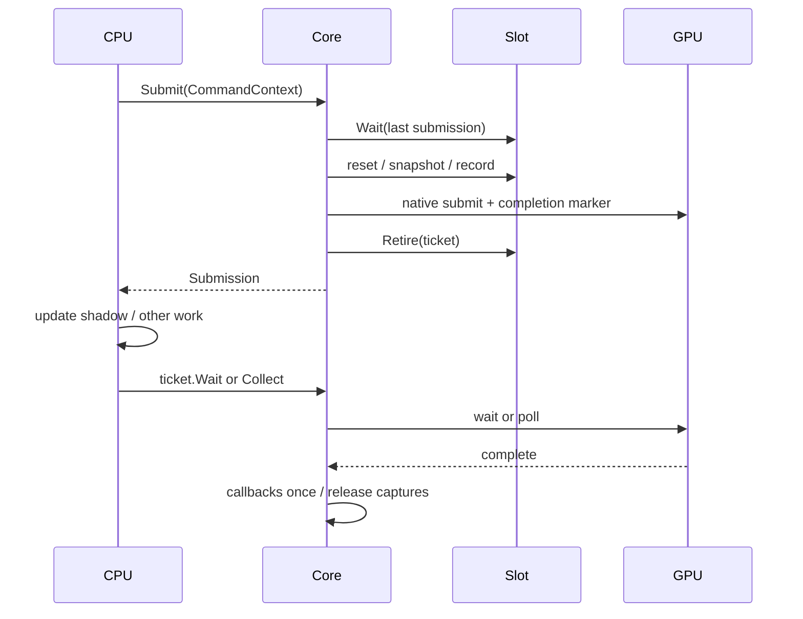

# RHI 第一版改造：提交、完成与在途回收

关联：Issue #85；后续 Render Graph 见 #83。本 PR 不关闭 #85。

## 范围

本版先落地单队列提交票据与提交槽回收，直接迁移 C++、Python、Sparkium、Snowberg、demo 和测试的提交调用，不提供旧名称适配器。提交不依赖窗口、呈现或帧计数。

这是 #85 的基础增量。原生资源版本自动保留、异步上传/读回 API、显式 Barrier API、逻辑绑定 schema/BindingPlan 尚未实现；不能据此认为整个 RHI 重构或 Render Graph 前置条件已经完成。

## 新增类与概念（按名称）

### `Submission`

文件：`code/grassland/graphics/submission.h/.cpp`。可复制的公开完成票据，共享内部状态。

- `IsValid()`：是否关联提交；默认构造无效。
- `QueueId()` / `Value()`：逻辑队列身份和单调提交序号。序号不要求连续，也不暴露原生 fence 值；只能在同队列内比较先后。
- `IsComplete()`：非阻塞查询，同时处理该提交的完成回调。
- `Wait()`：等待该提交，同时处理它的回调。
- 无效票据查询/等待抛 `logic_error`；GPU 查询/等待和回调异常会缓存，后续查询继续抛出。
- 完成后不再调用原生后端。Core 析构先 drain，因而票据可以在 Core 析构后查询最终结果。
- 主机侧操作要求外部串行化，不承诺线程安全。回调不允许重入本 Core 的提交/收集，也不允许查询自身票据。

```cpp
auto done = core->Submit(commands.get());
commands.reset();             // 提交已转成原生命令
do_cpu_work();
if (!done.IsComplete())
    done.Wait();              // 只在 CPU 确实需要完成结果时等待
// 此处才可以释放本提交引用的用户资源。
```

等待后面的票据不保证前面票据的 CPU 回调已经执行；需要 `CollectCompletedSubmissions()` 或逐个查询来收集它们。

### `detail::InFlightSubmission`

实现隐藏在 `.cpp` 中。保存队列身份、序号、原生 poll/wait 闭包、完成回调和终止异常。

```text
Pending -- poll未完成 --> Pending
Pending -- GPU完成 --> 清除原生闭包，逐个执行回调 --> Completed
Pending -- GPU失败 --> 清除闭包与回调捕获 --> Failed
回调抛异常 --> 继续执行其余回调，缓存首个异常 --> Failed
```

完成回调最多执行一次。GPU 失败不会执行成功回调，但会释放其捕获对象。本版这里保留的是完成所需状态和显式捕获的引用，尚未自动收集所有 Buffer/Image 原生版本。

### `detail::SubmissionQueue`

由 Core 私有持有，是完成记录管理器，不是新建的第二条硬件队列。

- `Track(poll, wait, callbacks, submit)`：先分配并登记内部状态，再调用原生提交闭包；提交失败移除记录并抛异常，不返回虚假票据。
- `Collect()`：查询并移除已终止记录，不主动等待 GPU。某项失败后仍处理其他记录，再抛首个异常。
- `WaitAll()`：等待当前记录并处理回调；某项失败不阻止其他项回收。
- `Shutdown()`：析构使用的非抛异常 drain；异常仍保留在幸存票据中。
- 丢弃公开票据不会丢失在途记录，也不会自动阻塞 CPU。

仅 `Track` 被授予构造 `Submission` 的窄友元权限；没有公开可变状态 getter。

### `detail::InFlightSlot`

保存上一次使用该槽的票据；`Wait()` 等待它，`Retire(ticket)` 记录新占用，并拒绝覆盖未完成的旧占用。

```text
slot = slots[next]
slot.Wait()                         // 必须在 reset/copy/重写描述符之前
CollectCompletedSubmissions()
reset allocator / descriptor pool
prepare immutable upload snapshot
record and submit native commands
slot.Retire(submission)
next = (next + 1) % slot_count
```

本版槽的原生对象仍存放在各后端按槽索引组织的数组中，`InFlightSlot` 负责复用约束。槽满时形成背压，`Submit()` 因此可能等待；不承诺永不阻塞。槽数默认 2、可配置正数，与交换链图像数和画面帧数独立。

未引入 `FrameContext` 或笼统的 `Arena`。后续上传分配器、描述符池、查询池应按实际职责单独命名。

## 修改类与接口（按名称）

### `graphics::Core` / `Core::Settings`

新增私有提交管理器、公开 `CollectCompletedSubmissions()`、受保护的 `TrackSubmission/WaitSubmissions/ShutdownSubmissions` 后端操作。`WaitGPU()` 保留为显式全队列 drain。

| 原接口 | 新接口 / 契约 |
| --- | --- |
| `int SubmitCommandContext(ctx)` | `Submission Submit(ctx)`；失败抛异常 |
| `Settings::frames_in_flight` | `Settings::submission_slot_count`，必须大于 0 |
| `FramesInFlight()` | `SubmissionSlotCount()` |
| `CurrentFrame()` | `CurrentSubmissionSlot()`，表示下次提交使用的槽 |
| `PushPostExecutionCallback(fn)` | `CommandContext::OnCompleted(fn)` |
| `GetPostExecutionCallbacks()` | 后端通过 `TakeCompletionCallbacks()` 转移所有权 |

### `graphics::CommandContext`

新增私有 `submission_started_`；完成回调容器改为私有。`BeginSubmission(core)` 检查归属 Core 和是否重复提交；进入提交后，即使失败也不能重试同一个 context。`OnCompleted()` 在提交后拒绝追加。三个后端拒绝空指针和错误后端类型。

尚未为全部 `Cmd*` 添加提交后录制检查；调用者应将 context 视为已消费，提交后立即销毁或停止使用。

### `backend::VulkanCore`

- 按槽复用 `VkFence`、command buffer、descriptor pool；先等待该槽，再 reset。
- 票据使用 `vkGetFenceStatus/vkWaitForFences`。完成状态在复用 fence 前缓存，旧票据不会受到下一次 reset 影响。
- 动态上传 copy 放进本次 graphics command buffer，沿用上传后内存 barrier。
- 删除共享 transfer command buffer 及常规提交末尾的 transfer queue idle。现有 transfer queue 与 graphics queue 本来就是同一 family/index，不宣称实现了异步传输队列。
- 开始/结束录制、fence reset、提交和等待错误传递为异常；析构在销毁 device/fence 前 drain。

### `backend::D3D12Core`

- 每槽 command allocator/list、resource/sampler/RTV/DSV heap 的重置与复用由完成票据保护。
- 动态 copy 并入本次 direct command list，删除独立 transfer queue/allocator/list。
- 票据绑定此次 signal 的 fence 值；检测 `GetCompletedValue() == UINT64_MAX` 的 device removal，并检查事件等待失败。
- 删除提交末尾等待下一个槽的旧流程，改为下次复用之前等待。
- 提交登记先于 Execute/Present/Signal。完成 fence 在 Present 之后 signal，使窗口 teardown 的 drain 也覆盖呈现排队操作。Present 失败时先 signal 并等待已经入队的工作，再报告失败，避免释放仍在途的回调捕获。

### `backend::MetalCore` / `MetalCommandContext`

- `Commit()` 返回统一 `Submission`，由闭包保留 `MTL::CommandBuffer`，查询 status 或 `waitUntilCompleted()`。
- 用统一完成管理器替换原 `pending_` deque、内部同名 Submission 和 `Reap()`。
- 增加与计算提交无关帧语义的槽索引；移除 context 独立的 `submitted` 标记，统一使用基类约束。
- AS generation、children、sampler 的已有保留回调迁移到 `OnCompleted()`。
- Metal buffer 上传仍采用原来的显式等待实现，本版没有把 Metal 上传改为异步。

### `backend::VulkanDynamicBuffer` / `D3D12DynamicBuffer`

仅删除队列等待会让 GPU 继续读取正在被 CPU 改写的共享 staging。本版增加每槽上传快照，保护新的异步提交行为。

```text
UploadData(bytes): 更新 CPU shadow
Submit:
    等待将复用的槽
    shadow -> slot.upload_snapshot       // CPU copy；大小变化时重新分配
    slot.upload_snapshot -> slot.device_buffer  // GPU copy
    录制消费 device_buffer 的命令
Submit 返回后:
    CPU 可以更新 shadow
    该槽 snapshot/device_buffer 保持不变直到提交完成
```

Vulkan 对快照执行 flush，确保非 coherent 内存可见。描述符仍指向本槽的设备 buffer。

冻结点是 **Submit 时**，不是录制 CmdBindResources 时。同一动态 buffer 在录制中间多次更新，仍不代表多个独立参数版本；需要不同 buffer 才能表达不同值。本版没有实现参数快照 API。

代价：额外 CPU memcpy，以及每个使用槽的上传分配；仍全量复制，没有脏区跟踪、上传 ring 或性能收益承诺。普通资源绑定路径得到上述保证；原生地址和 CUDA 互操作不新增异步安全承诺。

### `backend::VulkanWindow`

- image-available semaphore 按提交槽分配，复用前由该槽完成保护。
- render-finished semaphore 改为按交换链 image 分配。渲染 fence 完成并不表示 presentation 已消费 binary semaphore；按重新取得的 image 复用避免混淆两种生命周期。
- 重建、关闭、ImGui teardown 等管理操作等待 presentation queue；销毁交换链同时销毁对应 render-finished semaphore。
- Present 在递增提交槽之前执行，保持 acquire 对应关系。

### `backend::D3D12Window`

交换链使用独立的双图像配置，不再由提交槽数推导。ImGui 的原生 `NumFramesInFlight` 字段仍使用其原名，值取提交槽预算。

### `snowberg::visualizer::Core` / `OwnershipHolder`

移除 Core 内按槽存放的 holder 数组。每次 `Render()` 创建独立共享 holder，通过此次 context 的完成回调保留。

```cpp
auto ownership = make_shared<OwnershipHolder>();
context->OnCompleted([ownership] { ownership->Clear(); });
record_scene(context, ownership.get());
// 提交完成时仅清理本次 Render 收集的资源。
```

旧实现可能在新录制往同槽添加引用后，才执行旧提交回调并清空它们。按提交捕获解除这项时序耦合。`OwnershipHolder` 本身的类型定义未修改。

### Python `Submission`、`Core`、`Core.Settings`

注册 `Submission.is_valid/is_complete/wait` 与只读 `queue_id/value`；提交方法改名为 `submit()`，同步迁移 settings 和槽查询命名，新增 `collect_completed_submissions()`。

```python
done = core.submit(commands)
do_cpu_work()
done.wait()
core.collect_completed_submissions()
```

Python 也必须保留本提交使用的资源至完成；本版没有自动修复所有跨对象引用寿命。

### Sparkium、demo、Python 示例和既有测试

以下是调用迁移，不引入新的渲染算法：

- `sparkium::Film`、raster 的 `Film/Scene`、raytracing 的 `Film/Scene`：提交改用 `Submit()`。
- demo：2048、draw_n_gui、franka_kinematics、gol、graphics_hello 的全部提交模块、imgui、joystick_test、nbody_cs、nbody_cuda、practium_hello、sparkium_gui、thin_lens。
- Python：graphics_hello 各示例、nbody_cs、nbody_warp 改用 `submit()`。
- 测试：vulkan_compatibility、Sparkium fallback/HDR/Metal/window/Wayland probe；提交成功断言改为票据有效，重复提交断言改为异常。

## 同步与寿命边界



本版 `Submission` 只解决 CPU 对提交完成的观察和内部复用依据，**不能替代 GPU Barrier，也不能作为跨队列 GPU wait API**。用户的 Buffer/Image/Program/Sampler 及底层依赖仍需活到 GPU 完成，资源不能在途 resize 或销毁。

## 验证与后续

新增 `test_graphics_submission` 显式 Ninja 测试目标：覆盖无效票据、查询/等待、槽提前复用、旧票据稳定性、GPU 错误模拟、回调异常、提交失败、丢弃票据和 Core 析构 drain。GPU 测试在两槽下连续提交 12 个无窗口 compute，提交后立即覆盖 CPU shadow，核对全部输出与完成回调。另有 Vulkan/D3D12 连续 12 次呈现测试（`LONGMARCH_TEST_SUBMISSION_WINDOWS=1`），期间不主动逐次 WaitGPU，检查多槽复用与关闭窗口。该测试实际发现并促成了 D3D12 Present/fence 顺序修正。

验证环境：Windows、MSVC、Ninja Release，Vulkan 测试开启 `VK_LAYER_VALIDATE_SYNC=1`。

| 检查 | 结果 |
| --- | --- |
| 默认构建（含 Python 扩展、Sparkium、Snowberg） | 通过 |
| 显式目标 `demo_graphics_hello`、`demo_nbody_cs`、`demo_gol` | 构建通过 |
| `test_graphics_submission` | 10/10 通过：6 项主机状态测试，4 项 Vulkan/D3D12 compute/presentation GPU 测试 |
| `test_vulkan_compatibility` | 2/2 通过 |
| `sparkium_fallback_test` 的 Vulkan 窗口尺寸切换用例 | SDR 路径通过 |
| Vulkan HDR 交换链故障恢复用例 | 当前 surface 不支持 HDR，跳过 |
| Python 新接口 smoke | Vulkan/D3D12 均通过；提交 5 次，查询、等待、收集与 Core 释放后票据查询 |
| `pre-commit run`、`git diff --check` | 通过 |

只构建并运行上述相关目标和用例，没有宣称全量示例运行或全测试套件通过。Windows 无法验证 Metal 原生编译/运行。没有在本版做性能基准，不将减少 queue idle 等同于已证明性能提升。

#85 后续仍需：原生资源 generation 保留、异步上传/读回和 BufferSlice、resize 版本替换、资源访问/Barrier 描述、多队列依赖、BindingSchema/BindingPlan/参数冻结，以及分配/绑定/等待计数与性能测量。现有同步资源 API 和整数槽位绑定 API 只在对应后续阶段替换，本版没有为它们增加兼容层。
