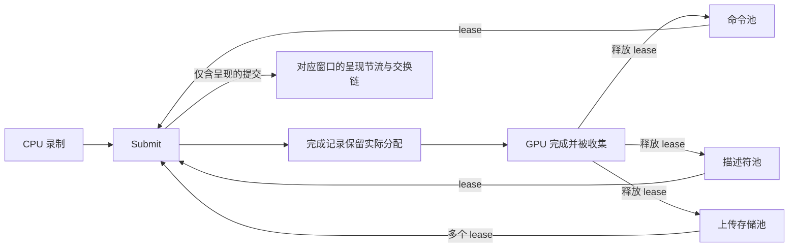

# RHI 第一版：提交完成、独立资源池与窗口局部呈现同步

关联：Issue #85；Render Graph 后续工作见 #83。本 PR 不关闭 #85。

## 本轮修正与总体范围

删除全局提交槽位。命令存储、描述符和动态上传存储独立申请、独立计费，按具体提交的完成情况回收。交换链图像和窗口呈现节流只影响需要呈现的工作；一帧内可以有多轮计算、拷贝和绘制提交。

本报告描述 PR 的最终状态，替代先前的固定提交槽设计。`InFlightSlot`、`CurrentSubmissionSlot()`、`SubmissionSlotCount()` 和 `submission_slot_count` 均已删除，没有换名保留相同循环数组。没有引入 `FrameContext` 或笼统的 `Arena` 类型。

本版覆盖单队列完成票据、后端临时对象池、动态上传快照和调用迁移。完整资源 generation 保留、异步上传/读回公共接口、显式 Barrier、多队列依赖及 BindingPlan 仍属于 #85 后续阶段。

## 新增或修改的类与设计（按名称）

### 1. `Submission`

文件：`code/grassland/graphics/submission.h/.cpp`。

可复制的公开完成票据，共享内部状态：

- `IsValid()`：默认构造无效。
- `QueueId()/Value()`：逻辑队列身份和单调提交序号；序号不保证连续，也不直接等于原生 fence 值。
- `IsComplete()`：非阻塞查询，并处理该提交的完成回调。
- `Wait()`：等待该提交并处理其回调。
- 无效票据查询或等待抛 `logic_error`；GPU 与回调错误会缓存，后续继续抛出。
- Core 析构先 drain，已终止票据不再访问原生后端，可以在 Core 析构后查询。

```cpp
auto done = core->Submit(commands.get());
commands.reset();
do_other_cpu_work();
done.Wait();
// 本次引用的用户资源此时才可释放。
```

主机访问需外部串行化。等待后一项提交，不代表前面所有提交的 CPU 回调都已被观察和执行；可调用 `CollectCompletedSubmissions()`。

### 2. `detail::InFlightSubmission`

内部保存队列身份、序号、原生 poll/wait 闭包、完成回调与终止异常。

```text
Pending -> native completion -> 清除原生闭包 -> 执行全部回调 -> Completed
Pending -> native failure    -> 清除闭包、释放捕获引用       -> Failed
回调抛异常 -> 继续执行其他回调 -> 缓存第一个异常
```

原生分配的 lease 被完成记录保留，GPU 完成并执行收集后才释放。GPU 失败不执行成功回调，但仍释放捕获。公开票据长期存活不会长期保留已完成分配。

### 3. `detail::SubmissionQueue`

由 Core 私有持有，管理完成记录，不代表额外硬件队列。

- `Track(poll, wait, callbacks, submit)`：先分配记录，再执行原生提交。提交失败删除记录并抛异常，不返回虚假完成票据。
- `Collect()`：不等待 GPU，处理已完成记录。单项错误不阻止其他项回收。
- `WaitAll()`：等待已有记录，处理全部回调后再报告首个错误。
- `Shutdown()`：析构使用的非抛异常 drain，错误保留在幸存票据中。

丢弃公开票据不会丢失在途引用。仅 `Track` 获得构造 `Submission` 的窄友元权限，没有公开可变内部状态 getter。

### 4. `detail::ResourcePool<T>`（新增）

文件：`code/grassland/graphics/resource_pool.h`。独立、惰性增长的内部资源池。

每个缓存项包含一个原生分配的共享所有权和成本。`Acquire(cost, matches, create)` 返回内部 lease：

```cpp
Acquire(request):
    if 存在“只有池自身持有”且满足需求的缓存项:
        return lease(缓存项)
    if 预算不足:
        淘汰空闲缓存项                       // 不碰任何在途 lease
    if 仍不足:
        throw ResourcePoolExhausted(pool_name)
    allocation = create()
    cache(allocation, cost)
    return lease(allocation)
```

使用 `shared_ptr` 所有权计数判定是否仍有 lease；这不是线程安全分配器，访问仍需串行化。每次提交的完成记录持有 lease，原生分配不会因下一次提交或另一窗口呈现而提前复用。

池不会每帧 reset，不维护全局当前索引。一个提交可持有多个上传分配；一个池可以增长而另一个池保持很小。闲置缓存会在本池需要空间时被淘汰，不主动周期性收缩。

### 5. `ResourcePoolExhausted`（新增）

继承 `std::runtime_error`，错误文本标识哪个池耗尽。它是本版明确的非阻塞背压结果，不会偷偷执行 `WaitGPU()`。

```cpp
try {
    done = core->Submit(commands.get());
} catch (const ResourcePoolExhausted&) {
    // 调用者决定稍后重录、等待已知在途工作，或减少本次工作。
    // 如果单次请求本身超过预算，等待不能解决，需要拆分工作或重新配置。
}
```

失败的 CommandContext 已消费，不能直接重试；应创建新的 context。已申请但尚未提交的 lease 自动释放。D3D12 在失败路径关闭已开始录制的 command list，保证后续可以安全 Reset。

### 6. `Core` / `Core::Settings`

公开 `Submit()`、`CollectCompletedSubmissions()`；私有持有 SubmissionQueue。`WaitGPU()` 仍是显式管理 drain。

最终配置：

| 字段 | 默认值 | 含义 |
| --- | --- | --- |
| `enable_debug` | 构建默认值 | 开启后端调试 |
| `command_pool_limit` | 256 | Vulkan/D3D12 命令分配块数量预算 |
| `descriptor_pool_limit` | 256 | Vulkan descriptor pool 数量预算；D3D12 每种 descriptor heap 池分别使用此数量预算 |
| `upload_pool_bytes` | 128 MiB | Vulkan/D3D12 动态上传存储的请求字节预算，包含 upload 与 device 两份存储 |

这些是独立池预算，不是预先分配数量，也不是在途帧数。预算必须为正。字节预算按请求大小计费，不包含驱动分配对齐、堆元数据等原生开销，不能当作物理显存占用的硬上限。

Metal 本版使用原生逐命令存储；这些新池预算目前用于 Vulkan/D3D12，不能宣称 Metal 已实现相同预算策略。

| 删除的接口 | 最终使用方式 |
| --- | --- |
| `SubmitCommandContext(ctx)` 返回 int | `Submit(ctx)` 返回 Submission，失败抛异常 |
| `FramesInFlight` / `SubmissionSlotCount` | 各池独立预算，没有全局数量查询 |
| `CurrentFrame` / `CurrentSubmissionSlot` | 删除；前端不按循环索引管理临时资源 |
| `PushPostExecutionCallback` | `OnCompleted` |
| `GetPostExecutionCallbacks` | 后端通过 `TakeCompletionCallbacks` 转移所有权 |

### 7. `CommandContext`

`BeginSubmission(core)` 检查 Core 归属和重复提交。提交尝试消费 context；`OnCompleted()` 在提交后拒绝追加。回调容器私有化。

回调运行在观察完成的主机线程上，不能重入同一 Core 的提交/收集，也不能查询自身票据。全部 `Cmd*` 的提交后录制检查尚未统一补齐，因此提交后应停止使用 context。

### 8. `VulkanCore::CommandAllocation` / `DescriptorAllocation`（新增）

- `CommandAllocation`：一个可复用 command buffer 和完成 fence，从 Core 的命令池按需申请；析构释放原生句柄。共享 `VkCommandPool` 不做按帧整体 reset。
- `DescriptorAllocation`：一个 VkDescriptorPool 及其各类型容量、max sets。独立匹配请求，空闲且容量足够才复用/reset。
- 两者来自独立 ResourcePool。记录完成后才有资格复用，旧 Submission 的缓存完成状态不会受 fence reset 影响。

```cpp
CollectCompletedSubmissions();
auto commands = command_pool.Acquire(...);
auto descriptors = descriptor_pool.Acquire(...);
auto uploads = prepare_dynamic_buffers();
record(commands, descriptors, uploads);
return TrackSubmission(native_poll, native_wait,
                       retain_until_completed(commands, descriptors, uploads),
                       native_submit);
```

常规提交不再在结尾等待 transfer queue idle。动态 copy 在同次 graphics command buffer 中；现有上传后 barrier 保留。没有声称增加了独立异步 transfer queue。

`current_descriptor_pool_` 仅是串行编译当前命令时的工作指针，不是跨提交索引或资源所有者。

### 9. `D3D12Core::CommandAllocation` / `DescriptorAllocation`（新增）

- 命令分配块持有 allocator 与 command list。
- resource、sampler、RTV、DSV 分别拥有独立 descriptor heap 池；匹配容量后才复用，互不共享轮转索引。
- 上传 copy 与工作命令进入同一个 direct command list。
- 完成票据绑定具体 fence 值，检查 device removal 和事件等待错误。
- Signal 位于 Present 之后，窗口 teardown 的 drain 覆盖呈现排队操作。Present 失败时完成必要的 signal/等待后报告错误。
- `CloseOnFailure` 清理未完成的录制，使资源池压力失败后的命令块仍可复用。

当前 heap 指针只在串行原生命令编译中使用；分配寿命由 lease 和完成记录负责。

### 10. `VulkanUploadAllocation` / `D3D12UploadAllocation`（新增）

一项动态 buffer 存储包含 device buffer 与 CPU 可写 upload buffer。两者的大小在分配生命周期内固定，共同保留到消费它们的提交完成。

这些分配由 Core 的独立上传存储池管理，可以跨不同逻辑 buffer 复用同尺寸的空闲块；不会为每个 buffer 预建 N 个副本。Vulkan 析构用 VMA 释放，D3D12 使用 ComPtr。

目前分配单位仍是整块 buffer，没有实现 upload page 子分配、BufferSlice 或 dirty range 跟踪；这也意味着本版仍有额外 CPU memcpy 和整段 GPU copy。

### 11. `VulkanDynamicBuffer` / `D3D12DynamicBuffer`

删除按全局索引选择的 device/upload 数组。保留 CPU shadow；`TransferData()` 从池取得独立存储、复制 shadow、录制 GPU copy，并返回 lease 供此次提交保留。

```text
CPU UploadData -> shadow
Submit A -> allocation A <- shadow snapshot A -> GPU
CPU UploadData -> shadow changes
Submit B -> allocation B <- shadow snapshot B -> GPU
A observed complete -> release lease A -> pool may reuse A
```

冻结点仍为 Submit 时，不是 Bind 时。Vulkan flush 非 coherent upload allocation。原生访问指针仅供本次命令编译使用，不具备跨提交稳定性。

### 12. `VulkanCommandContext` / `D3D12CommandContext`

`CmdCopyBuffer()` 现在也登记源、目标中的动态 buffer，使复制命令经过同一快照与存储保留路径。此前只在绑定路径登记，不能覆盖直接复制。这项修改由上传池压力恢复测试覆盖。

### 13. `VulkanWindow`

交换链图像与 acquire 同步独立管理：

- render-finished semaphore 按交换链 image 管理；渲染完成不等于呈现引擎已消费 semaphore。
- 每个窗口独立维护两个 acquire semaphore 和各自的最后消费 Submission。`AcquireNextImage()` 只等待该窗口将复用的 acquire 对象。
- `RetireAcquire()` 记录真实消费提交。其他窗口和纯计算提交不会推进此窗口的 acquire 索引。
- 重建/关闭等操作等待 presentation queue，安全释放交换链及相关 semaphore。

这个二项呈现节流属于窗口局部策略，并非 RHI 资源池大小。acquire semaphore 在获得 image index 前就必须提供，因此不能把所有同步对象简单绑定到 image index。

### 14. `D3D12Window`

双图像交换链独立于 RHI 池。新增 `PrepareSubmission()/RetirePresentation()`，每窗口保留两次呈现完成记录，限制窗口自身的提前呈现程度，并保护 ImGui 的双份原生动态存储。普通计算/拷贝提交不推进该索引。

### 15. `MetalCore` / `MetalCommandContext`

统一使用 Submission 和完成记录保留 `MTL::CommandBuffer`；删除本 PR 早期增加的固定提交槽限流。已有原生逐命令存储随命令完成释放。

AS generation/children 与 sampler 的已有保留逻辑使用 `OnCompleted()`。Metal shared buffer 更新仍会走现有同步路径，argument buffer 尚未改成新的缓存池。Windows 无法验证 Metal 原生编译与运行。

### 16. `snowberg::visualizer::Core` / `OwnershipHolder`

每次 Render 单独创建共享 OwnershipHolder，通过该 context 的完成回调保留。删除按全局索引存放 holder 的数组，避免旧提交回调清理新录制加入的引用。OwnershipHolder 类型自身未改。

```cpp
auto ownership = make_shared<OwnershipHolder>();
commands->OnCompleted([ownership] { ownership->Clear(); });
record_scene(commands, ownership.get());
```

### 17. Python `CoreSettings` / `Core` / `Submission` / `ResourcePoolExhausted`

注册新异常类型、Submission 查询与等待、Core 收集方法。删除槽数构造参数与当前槽查询，公开独立预算字段；nbody 示例同步迁移。

```python
settings = graphics.CoreSettings(enable_debug=True,
                                 command_pool_limit=64,
                                 descriptor_pool_limit=128,
                                 upload_pool_bytes=32 * 1024 * 1024)
core = graphics.Core(api, settings)
done = core.submit(commands)
done.wait()
core.collect_completed_submissions()
```

### 18. 上层调用与测试目标

以下为提交 API 或 settings 调用迁移，没有引入新的渲染算法：

- Sparkium 的 Film、raster Film/Scene、raytracing Film/Scene。
- demo：2048、draw_n_gui、franka_kinematics、gol、graphics_hello 各模块、imgui、joystick_test、nbody_cs、nbody_cuda、practium_hello、sparkium_gui、sparkium_cli、thin_lens。
- Python：graphics_hello 各提交示例、nbody_cs、nbody_warp。
- 测试：vulkan_compatibility、Sparkium fallback/HDR/Metal/window/Wayland probe。
- 新增显式 Ninja 目标 `test_graphics_submission`，覆盖完成状态、独立池预算和 GPU 回归。

## 生命周期示意



池预算限制资源压力；窗口节流控制呈现提前程度。它们没有共同索引。背压也不保证 Submit 永不阻塞：窗口 acquire/present、驱动原生分配等仍可能等待，但池耗尽本身明确报告错误，不主动等待整个队列。

## 验证

环境：Windows / MSVC / Ninja Release；Vulkan 开启 `VK_LAYER_VALIDATE_SYNC=1`，D3D12 开启 debug layer。

- 提交与资源池测试：14/14 通过，含 6 项提交状态、2 项确定性的池生命周期/预算、6 项 Vulkan/D3D12 GPU 用例。
- 池模拟测试在完成前申请 8 项，确认无隐式等待；仅完成第 4 项后就能精确复用它，与另一池预算无关。
- 上传预算恢复：768 字节预算不能容纳两份 256 字节 upload/device 对；失败后重新录制较小工作，核对结果并验证 command allocator/list 可安全复用。
- 无窗口计算：连续 12 次动态参数提交，提交后立即覆盖 CPU shadow，核对全部 GPU 输出和回调。
- 多轮提交与呈现：每帧先提交 5 轮工作再呈现，共 12 轮；第二窗口每 3 轮参与一次，验证窗口同步互不推进。
- 默认 Release 构建及显式 graphics_hello、nbody_cs、gol、Vulkan compatibility、Sparkium fallback 目标构建通过。
- Vulkan compatibility 2/2 通过；Python Vulkan/D3D12 的新 Settings、连续提交、等待、收集及 Core 释放后票据查询均通过。
- 开启桌面测试后，Vulkan 窗口尺寸切换与 HDR 交换链故障恢复 2/2 通过；故障注入产生的预期错误日志不表示测试失败。
- `pre-commit run` 和 `git diff --check` 通过。Metal 留待 macOS 原生验证。未运行全量测试套件或性能基准。

## 明确的边界与后续

这版会保留 RHI 池分配及显式捕获引用，但尚未自动保留所有用户 Buffer/Image/Program/Sampler 的原生版本；用户资源仍需活到完成。同步资源 API、整数绑定槽位和整体更新语义尚未全部替换。

`Submission` 不替代 GPU Barrier，不提供跨队列 GPU wait。仍需实现 generation 保留、异步上传/读回、BufferSlice、resize 版本替换、显式资源访问与 Barrier、BindingSchema/BindingPlan、Metal 池策略及性能计数。未进行性能基准，不宣称吞吐已提高。
